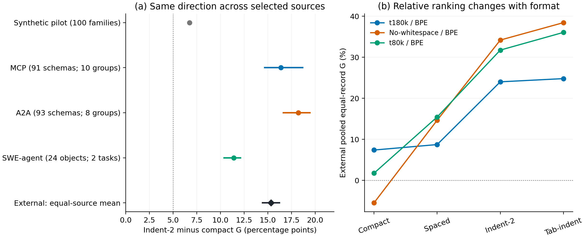

# JSON serialization sensitivity of released SuperBPE tokenizers

An independent, AI-assisted technical investigation by **Zhijing Wu**. No affiliation with UW or the original SuperBPE team is implied. Original project materials are licensed under [MIT](LICENSE), within the scope stated in [NOTICE](NOTICE.md).

Repository: [ZhijingWu/superbpe-serialization-evaluation](https://github.com/ZhijingWu/superbpe-serialization-evaluation).

## Question and original contribution

Does changing only JSON serialization whitespace change the relative token savings of a fixed released tokenizer on an unchanged semantic object?

Alisa Liu, Jonathan Hayase, Valentin Hofmann, Sewoong Oh, Noah A. Smith and Yejin Choi introduced SuperBPE's subword-to-superword curriculum and evaluated trained language models in [SuperBPE: Space Travel for Language Models](https://arxiv.org/abs/2503.13423v3), COLM 2025 camera-ready. Their whitespace, digit and colon controls are part of the original work. We credit the [original release](https://github.com/PythonNut/superbpe/tree/bbd09768fc28a875cef48e6bdd66e3a17454628e), [FAQ](https://superbpe.github.io/faq.html), and [punctuation/newline discussion](https://github.com/PythonNut/superbpe/issues/9).

Here we independently measure **fixed-released-tokenizer counts under paired serialization**. We do not reproduce the paper's training data or language-model experiments, and we do not causally isolate the training curriculum.

## Principal results

Let `G = 1 - N_t180k / N_BPE` and `D = G_indent2 - G_compact`. A difference of 0.05 is five percentage points (pp).

| Evaluation | Objects / statistical grouping | D | 95% bootstrap interval |
|---|---|---:|---:|
| Frozen synthetic pilot | 100 held-out families, 25/category; 40 schema lineages | +6.72 pp | [6.48, 7.00] pp |
| MCP schema definitions | 91 objects; 10 coarse schema groups | +16.38 pp | [14.60, 18.75] pp |
| A2A schema definitions | 93 objects; 8 coarse schema groups | +18.22 pp | [16.55, 19.51] pp |
| SWE-agent arguments/states | 24 objects; **only two benchmark tasks** | +11.41 pp | [10.30, 12.20] pp |
| External equal-source summary | Three equally weighted source means; 208 unique objects | +15.34 pp | [14.37, 16.30] pp |

The synthetic endpoint uses the frozen +/-5 pp practical margin. The external evaluation is separate and descriptive. Its intervals condition on the selected source/schema/task groups; they are **not population intervals for production deployments**. Schemas are authentic released artifacts, not agent executions. No synthetic/external pooling occurred. See [methodology](docs/methodology.md) and [limitations](docs/limitations.md).



The figure's left panel compares separate finite sets and their conditional intervals; the right panel uses external pooled equal-record averages. The dotted 5 pp reference comes from the synthetic protocol, not a new external significance rule. Different weighting definitions remain distinct.

| Set / format | BPE tokens | t180k tokens | No-whitespace tokens |
|---|---:|---:|---:|
| Synthetic compact | 26,505 | 23,657 | 23,304 |
| Synthetic indent-2 | 31,680 | 26,247 | 24,083 |
| External compact | 24,624 | 22,462 | 25,625 |
| External indent-2 | 41,378 | 31,246 | 26,757 |

Indentation increases absolute t180k tokens despite its larger relative advantage. The no-whitespace baseline beats t180k on **201/208** external indent-2 objects, but loses in the compact corpus. t180k regresses versus ordinary BPE on one compact and 16 spaced external objects. All formats, counterexamples and t80k sensitivities are retained in [saved results](results/external/external_source_metrics.csv).

## Mechanism and scope

t180k and no-whitespace have identical inference pretokenizers but different learned vocabularies and merge lists. A labeled post-count static audit finds **893 colon-space token types in no-whitespace and zero in t180k/t80k/BPE**. The SuperBPE restriction is already documented in Appendix A.1.4 of the paper. Saved byte partitions support structural-formatting/vocabulary explanations; regional count accounting is not causal mediation. See [mechanism summary](docs/mechanism.md).

The evidence does not establish 208 independent executions, production-scale validation, better reasoning or accuracy, faster end-to-end inference, lower commercial API costs, a new undocumented bug, or a single-variable curriculum effect. The note is an **independent draft**, not a peer-reviewed publication.

## Reproduce statistics without downloads

From this repository root, using Python 3.12.14 (the verified portable replay environment):

```sh
python scripts/verify_results.py
```

This uses the standard library, saves replay outputs under ignored `build/replayed/`, and checks the reported statistics, bootstrap draws and comparison CSVs byte-for-byte. It makes no network requests or encoding calls. The original encoding runtime was Python 3.13.5 with `tokenizers==0.20.3`; that package is unnecessary for statistical replay.

To run one analysis directly:

```sh
python scripts/analyze_synthetic.py --root results/synthetic --output build/synthetic
python scripts/analyze_external.py --root results/external --output build/external
```

The release ports change metadata/check filenames, require a separate output path, and explicitly preserve the original CRLF JSON-output bytes; statistical formulas are unchanged. Git attributes preserve numerical evidence bytes across checkouts. Raw numerical observations remain byte-identical to the frozen files. Safe metadata projections and omissions are documented in [release derivations](configs/release_derivations.json).

## Assets needed for input/encoding replay

Statistical replay needs only this tree. Optional full external re-encoding needs the four [pinned tokenizer assets](configs/tokenizers.json) and the [pinned public sources](configs/sources.json). Raw schemas, source code, selected trace text, full conversations and tokenizer JSONs are not redistributed here.

The explicit acquisition/extraction/encoding commands and their limits are in [reproducibility instructions](docs/reproducibility.md). External input recovery was checked against all 832 frozen serialization hashes using existing cached sources. The prepared encoding wrapper was syntax/CLI checked; it was **not run during release preparation**. Do not confuse these different verification levels.

Synthetic raw fixtures and their phrase-bearing generator remain **private by the owner's publication decision**. Counts-only statistical replay is complete; full synthetic re-encoding requires authorized private access. All raw-input reproduction is therefore not publicly available.

The original Windows tokenizer checkout uses CRLF bytes, whereas raw GitHub downloads use LF. [Both hashes are recorded](configs/tokenizers.json); parsed models and derivative configuration hashes are identical. Use the raw-download hash for downloads, not the historical checkout hash.

## Note, rights and remaining questions

Read the [two-page Technical Note draft](docs/technical_note.pdf) or its [standalone LaTeX source](docs/technical_note.tex). The original evidence remains private and unchanged outside this tree. No third round was run.

Remaining questions concern broader independent task coverage and controlled boundary-policy effects with fixed vocabularies/merges. Neither is required for the current narrowly framed note. Any new experiment needs a separately frozen protocol and explicit approval.

Original project code and other original included materials are licensed under [MIT](LICENSE); read [NOTICE](NOTICE.md) for the scope and exclusions. Upstream assets retain their own terms. Raw synthetic inputs, their generator, third-party raw assets, and private reports are excluded from the published file set.
